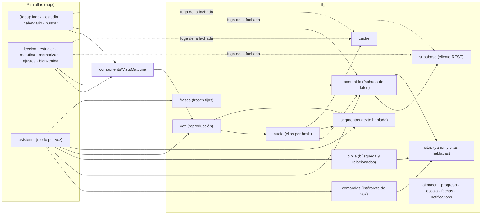
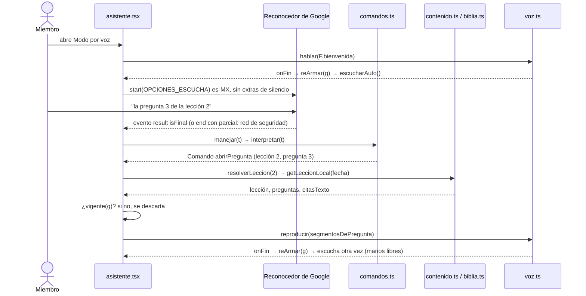
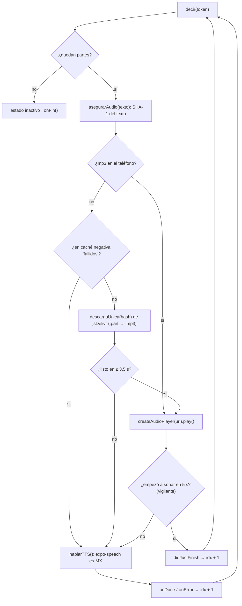
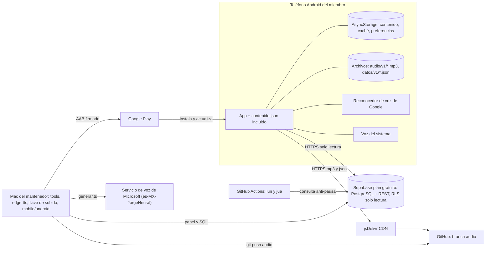

# Arquitectura

Vistas 4+1 de Kruchten, estilo, patrones y escenarios de atributo de calidad.
Verificado contra `main` en `e4e9dd5`. Las rutas son relativas a `mobile/` salvo que digan otra cosa.

## Estilo arquitectónico

**Cliente-servidor con offline-first (caché local).** Los clientes (teléfonos) piden y dos servidores responden:
Supabase (texto, REST de solo lectura) y jsDelivr (archivos estáticos: mp3 y JSON de búsqueda).
Pero las pantallas **leen siempre del almacén local** (`lib/contenido.ts`, archivos en el teléfono); la red solo
refresca en segundo plano. Por eso la app sigue funcionando si el servidor se cae o se pausa.

Las herramientas del mantenedor (`db/`, `tools/`) siguen un estilo de **tubos y filtros por lotes**:
cuaderno → JSON → SQL → Supabase → `snapshot_contenido.ts` / `generar.ts` → `assets/contenido.json` / branch `audio`.

## Vista lógica: ¿qué hace el sistema?



| Módulo (`lib/`) | Responsabilidad | Depende de |
|---|---|---|
| `contenido.ts` | Almacén del año: carga, sincroniza, consulta (`getVersiculoLocal`, `getLeccionLocal`, `leccionVigente`, `dondeSeCita`, `buscarTextoLocal`) | `supabase`, `citas`, `assets/contenido.json` |
| `supabase.ts` | Cliente y tipos `VersiculoDia`, `Leccion`, `Pregunta`; consultas directas | — |
| `cache.ts` | Caché `cache:*` en AsyncStorage (capa anterior a `contenido.ts`) | — |
| `comandos.ts` | `interpretar(texto) → Comando` (22 intenciones), sin IA | `citas`, `fechas` |
| `citas.ts` | Canon de 66 libros, `parseCita`, `anclaDeCita`, `citaHablada`, `palabrasANumeros` (TS puro) | — |
| `biblia.ts` | Descarga `datos/v1`, `obtenerVersiculo`, `buscarEnBiblia`, `versiculosRelacionados`, similares | `citas` |
| `voz.ts` | Cola de lectura `reproducirPartes`, `pausar`, `continuar`, `detenerVoz`, estado observable | `audio`, `segmentos` |
| `audio.ts` | mp3 por SHA-1: `asegurarAudio`, `descargarSemana`, `descargarTodo`, `limpiarViejo` (14 días) | `contenido`, `segmentos`, `cache`, `fechas` |
| `segmentos.ts` | Qué se dice y en qué partes (`segmentosMatutina`, `segmentosLeccion`, `citaParaVoz`); compartido con `tools/gen-audio` | tipos de `supabase` |
| `frases.ts` | Frases fijas del modo por voz (`F`, `frasesFijas()`); compartido con `tools/gen-audio` | — |
| `almacen.ts`, `progreso.ts`, `escala.ts` | Preferencias locales: recordatorio, racha, velocidad, avance por lección, bienvenida, tamaño de letra | AsyncStorage |
| `notifications.ts` | Recordatorio diario local (`programarRecordatorioDiario`) | expo-notifications |

## Vista de procesos: ¿cómo corre?

**Arranque** (`app/_layout.tsx`, en paralelo y sin bloquear la pantalla): `cargarEscala()`, `prepararAudio()`,
`sincronizarContenido()` (si hay red) y después `descargarSemana()`, `limpiarViejo()` y `descargarDatos()`.

**Modo por voz** (`app/asistente.tsx`). Cada comando incrementa una *generación* (`nuevoComando()`); un manejador
asíncrono viejo se descarta con `vigente(g)` para no hablar encima del nuevo ni tras salir de la pantalla.



**Reproducción con respaldo TTS** (`lib/voz.ts`, `decir()`; `lib/audio.ts`, `asegurarAudio()`). Un `token`
global invalida la secuencia al pausar, detener o iniciar otra.



## Vista de desarrollo: ¿cómo se organiza el código?

```
App_Iglesia/
├── mobile/                 App Expo (TypeScript)
│   ├── app/                Pantallas (Expo Router): (tabs)/, leccion, estudiar, matutina,
│   │                       memorizar, ajustes, bienvenida, asistente, _layout
│   ├── components/         VistaMatutina, SelectorVelocidad
│   ├── lib/                Lógica (ver vista lógica). segmentos/frases/citas son TS puro
│   ├── assets/contenido.json  Copia incluida del contenido (snapshot)
│   └── android/            Proyecto nativo. FUERA DE GIT (mobile/.gitignore), editado a mano
├── tools/
│   ├── gen-audio/generar.ts      Genera mp3 con edge-tts (salida out/v1, fuera de git)
│   └── datos/                    snapshot_contenido.ts, build_biblia.py, build_relacionados.py, build_relacionadas.py
├── db/                     Seeds SQL por semestre y scripts _build_*.py (RV1909 de api.getbible.net)
├── docs/                   Sitio público de GitHub Pages (privacidad, términos). No es documentación interna
├── legal/                  Textos legales y guía de Play (autorizacion-iglesia.md fuera de git)
├── play-assets/            Gráficos de la ficha de Play
├── .github/workflows/      mantener-supabase.yml
└── mantenimiento/          Este manual
Branch `audio`:  v1/<sha1>.mp3 (2,673 clips, ~111 MB) · datos/v1/*.json (Biblia ~4 MB, relacionados)
```

## Vista física: ¿dónde corre?



## Escenarios (+1): los casos que unen las vistas

| Escenario | Recorrido |
|---|---|
| E1. "La matutina de hoy" por voz, sin internet | Lógica: `asistente` → `comandos` → `contenido`. Procesos: secuencia de voz + respaldo TTS. Física: todo dentro del teléfono (el reconocedor puede requerir red según el teléfono) |
| E2. El mantenedor agrega una nota | Física: Mac → Supabase y Mac → Microsoft → GitHub `audio`. Desarrollo: `tools/`. Lógica: `segmentosMatutina` añade "Nota. …" con hash nuevo |
| E3. Primer arranque sin red con Supabase pausado | Lógica: `cargarStore()` usa `assets/contenido.json`. Procesos: `sincronizarContenido()` falla en silencio |

## Patrones que ya usa el código

| Patrón | Dónde | Qué resuelve |
|---|---|---|
| **Facade** | `lib/contenido.ts`: `cargarStore`, `getVersiculoLocal`, `getLeccionLocal`, `dondeSeCita`, `buscarTextoLocal` | Una interfaz simple que esconde AsyncStorage, Supabase y la copia incluida. Es una fachada con fugas: Inicio, Calendario, Estudio, Memorizar, Lección y el asistente todavía llaman a `lib/supabase.ts` directamente (y casi todas a `lib/cache.ts`) |
| **Singleton** (de módulo, perezoso) | `contenido.ts`: variables `store` y `cargando` en `cargarStore()`; `biblia.ts`: `biblia`/`cargandoBiblia` en `cargarBiblia()`; `voz.ts`: un solo `player` | Una sola copia en memoria del contenido (y de la Biblia de ~31 mil versículos), aunque varias pantallas la pidan al mismo tiempo |
| **Observer** | `voz.ts`: `setEstadoVoz` → `oyentes`, `useEstadoVoz()` con `useSyncExternalStore`; `audio.ts`: `suscribirDescarga()` / `emitir()` (Ajustes se suscribe); `escala.ts`: `setEscala()` / `useEscalaTexto()` | Varias pantallas se enteran de "Preparando audio…", del avance de la descarga o del tamaño de letra sin conocerse entre sí |
| **Strategy / respaldo** | `voz.ts`: `decir()` elige en tiempo de ejecución entre el mp3 neural (`createAudioPlayer`) y `hablarTTS()` (expo-speech) según `asegurarAudio()` | Dos algoritmos para "decir un texto"; la lectura nunca queda muda |
| **Adapter** | `citas.ts`: `citaHablada()` traduce lo que dicta el reconocedor ("juan 316", "primera de corintios 13 4") a "Libro C:V"; `segmentos.ts`: `citaParaVoz()` traduce "Juan 3:16" a "Juan capítulo 3, versículo 16" | Formatos incompatibles entre el reconocedor, los datos y el lector de voz |
| **Comando + despachador** | `comandos.ts`: tipo `Comando` (unión discriminada); `asistente.tsx`: `ejecutar(c, g)` con un `switch` | Separa entender la frase (puro y probable) de ejecutarla |

**Tácticas de calidad** (Bass): disponibilidad con copia incluida, caché local, respaldo TTS, vigilante de 5 s,
descarga atómica `.part` → `.mp3`, caché negativa `fallidos`; usabilidad con sugerencias por contexto
(`sugerencias()`), red de seguridad con la transcripción parcial y mensajes de error en español (`errorDeMicrofono()`);
rendimiento con descarga semanal anticipada y carga perezosa de la Biblia.

**Cohesión y acoplamiento.** `citas.ts`, `segmentos.ts` y `frases.ts` tienen cohesión funcional y se comparten con
`tools/` por **acoplamiento de datos** (solo funciones puras). La excepción es `app/asistente.tsx` (1,238 líneas,
cohesión baja; ver [forma-de-trabajo.md](forma-de-trabajo.md#deuda-técnica-principal)). Complejidad ciclomática
(`npm run complejidad`): `interpretar` 69 y `citaHablada` 30 son altas pero están cubiertas por el corpus de
pruebas; `Asistente › ejecutar` (29), `hVersiculosRelacionados` (22) y `hBuscarVersiculo` (19) no tienen pruebas. Acoplamiento oculto: los
anuncios "Matutina del D de M." y "Lección N. Título." se escriben igual en `asistente.tsx` y en
`tools/gen-audio/generar.ts`, fuera de `frases.ts`; si uno cambia y el otro no, ese anuncio cae a la voz del sistema.

## Escenarios de atributo de calidad (6 partes)

**QA-1. Disponibilidad sin conexión** (RNF-01)
- Fuente: un miembro recién instalado.
- Estímulo: abre la app y pide la matutina de hoy (pantalla o voz).
- Artefacto: `lib/contenido.ts` + `assets/contenido.json`.
- Entorno: sin internet y con Supabase pausado.
- Respuesta: muestra la matutina y las lecciones desde la copia incluida, sin pantalla de error.
- Medida: 100 % de las 365 matutinas, 30 lecciones, 428 preguntas y 548 citas disponibles sin red.

**QA-2. Usabilidad por voz** (RNF-03)
- Fuente: un miembro mayor o con baja visión.
- Estímulo: dice una petición del corpus, p. ej. "la pregunta 3 de la lección 2".
- Artefacto: `lib/comandos.ts` y `app/asistente.tsx`.
- Entorno: operación normal, reconocedor de Google en es-MX.
- Respuesta: ejecuta la intención correcta y empieza a leer.
- Medida: ≥ 95 % de intención correcta en el corpus de pruebas; el audio empieza en ≤ 3.5 s o cae a la voz del sistema (≤ 5 s si el mp3 falla).

**QA-3. Accesibilidad** (RNF-02)
- Fuente: un miembro que usa TalkBack y letra grande.
- Estímulo: recorre Inicio y toca "Escuchar".
- Artefacto: pantallas de `app/` y `components/`.
- Entorno: TalkBack activo, letra del sistema grande y escala "Muy grande" (1.4×).
- Respuesta: cada control se anuncia con nombre y rol; el texto crece sin cortarse.
- Medida: 100 % de controles con `accessibilityLabel`/`accessibilityRole`; objetivos ≥ 48 dp; contraste ≥ 4.5:1.

**QA-4. Mantenibilidad: contrato de audio por hash** (RNF-04)
- Fuente: el mantenedor.
- Estímulo: corrige una nota o el texto de una pregunta.
- Artefacto: `lib/segmentos.ts`, `tools/gen-audio/generar.ts`, branch `audio`.
- Entorno: mantenimiento, sin publicar versión de la app.
- Respuesta: se generan solo los clips de los textos nuevos (SHA-1 nuevo) y la app los encuentra sola; los viejos ya no se piden.
- Medida: 0 líneas de código cambiadas; menos de 30 minutos de trabajo.

**QA-5. Costo** (RNF-05)
- Fuente: crecimiento de la congregación.
- Estímulo: 100 miembros usan la app a diario y descargan todo el audio (~111 MB cada uno).
- Artefacto: infraestructura (Supabase, jsDelivr, GitHub, Google Play).
- Entorno: operación normal.
- Respuesta: el audio se sirve del CDN gratuito; Supabase solo entrega el texto.
- Medida: $0 al mes y uso de Supabase bajo la cuota gratuita. Ojo: cada arranque con internet baja todo el texto (~370 KB sin comprimir); ver riesgo R-12.
